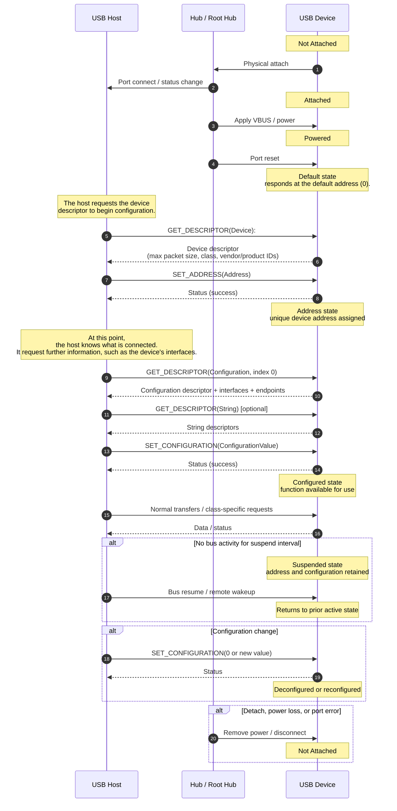

# What happens when you plug in a USB device ?

A whole bunch of stuff happens under the hood when you plug in a USB device. In the little pinguin challenge, we focus on the whole "attaching a driver" part, but as you probably guessed, that happens at the very end of the process.

Said process is described in detail in [section 9.1 of the USB 3.2 specification](./.assets/USB%203.2%20Revision%201.1.pdf). Below is an (AI generated, human annotated) sequence diagram of the process.

